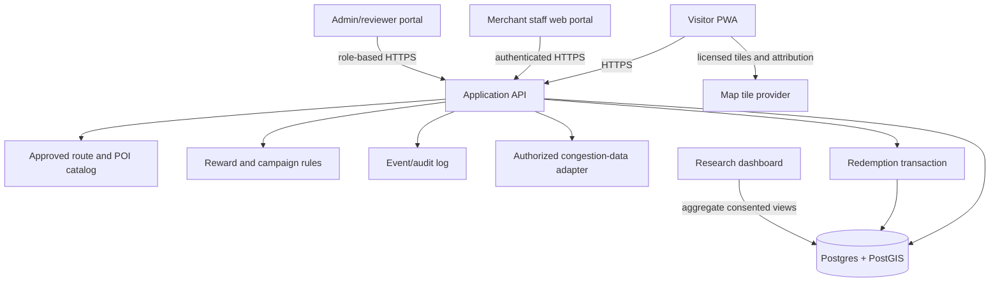

# Kyoto Flow — Engineering Specification

**Version:** 1.0 · Proposed technical architecture  
**Status:** Implementation blueprint for R0 prototype; additional approvals required for R1 operational pilot  
**Read with:** [`PRODUCT_REQUIREMENTS.md`](./PRODUCT_REQUIREMENTS.md) · [`design_system.md`](./design_system.md)  
**Implementation audience:** Full-stack engineer / Codex CLI / coding agent

> **Engineering invariant:** Never let a polished demo imply a capability the system cannot verify. Safe, approved routing; honest crowd-data provenance; server-authorized rewards; and clear separation between simulation and production are more important than visual completeness.

## 1. Decisions, assumptions, and boundaries

### Recommended stack (substitutable with explicit decision record)

| Concern | Initial selection | Reason / caveat |
|---|---|---|
| UI | Next.js App Router + React + TypeScript strict | Mobile-first PWA, route deep links, server endpoints; Vite+React is a viable alternative if simpler |
| Styles | Tailwind CSS + typed design tokens | Shared visual system in `design_system.md`; no ad hoc magic values |
| Illustrative game elements | SVG/CSS first; Phaser only if needed | A full game engine is not required for a fox marker and map animations |
| Maps | MapLibre GL JS + licensed vector tile/style provider | Two styles sharing the **same route geometry**; respect map provider attribution/license |
| Routing | Editor-reviewed geometry for R0/R1; trusted routing service for candidate generation | Do not ask an LLM to invent walkable paths |
| Backend/data | Postgres + PostGIS (e.g., Supabase) | Geospatial checks and transactions; RLS/role controls needed |
| Auth/session | Secure server-issued anonymous guest cookie; verified staff auth | Guests can browse anonymously; merchants/admins cannot |
| API boundary | Next.js route handlers or dedicated server API | Server-only validation of mission, reward, redemption and admin actions |
| State | React Query/server state + Zustand for UI preferences if justified | Avoid making localStorage the source of truth for rewards |
| Validation | Zod or equivalent on every external input | Strict schema validation including all timestamps/IDs |
| Localization | `next-intl` or `i18next` with EN/JA parity | User-facing text separated from business rules |
| Testing | Vitest + React Testing Library + Playwright + SQL integration tests | Verification of UI, accessibility, security and concurrency |
| Hosting/ops | Managed HTTPS hosting, database and error monitoring | Separate preview, staging and production secrets |

**Do not hardcode:** Map or congestion licenses, partner APIs, real merchant offers, municipal endorsement, crowd forecasts, fare values, step-free routing status, or transit voucher functionality.

### Technical non-goals (R0 and initial R1)

No passive background iOS GPS, HealthKit/Health Connect access from an ordinary PWA, coin transfers, payment processing, stored-value wallet, reliable mode-of-travel determination from isolated GPS checks, autonomous AI path generation, or wireless crowd-sensor deployment.

## 2. Architecture and trust boundaries



**Trust boundary rules**

1. Browser GPS, time, cookies, QR payloads, staff clicks and local cache are **untrusted input**.
2. Server decides check-in validity, mission completion, reward eligibility, redemption and campaign quota. A browser cannot set `rewardEarned=true`.
3. No service-role/database admin secret in client bundles. Use public/anon keys only where explicitly supported and constrained by RLS; keep privileged mutations server-side.
4. Every live route, merchant and congestion integration must have source provenance and valid permission/license.
5. UI feature flags do not provide security; production server endpoints independently reject demo events and tokens.
6. Research consent and analytics are separate from operational location/check-in evidence.

## 3. Environments and hard isolation

| Environment | Dataset | Reward behavior | Allowed users |
|---|---|---|---|
| `development` | Synthetic and flagged seeds | Demo voucher only; bypasses possible only via explicit simulator endpoint | Local developers |
| `preview` | Synthetic and possibly sanitized sample | Large persistent **DEMO — NOT REDEEMABLE** label; no production grant endpoints | Product reviewers |
| `staging` | Test partners / test vouchers only | Staff redemption in isolated test ledger | Authorized testers |
| `production` | Approved, signed-off catalog | Real coupons only for contracted offers | Public visitors + authenticated staff |

- Split database projects/schemas, signing keys, QR issuers, and domain/origin allowlists; do not point a preview to production redemption credentials.
- `DEMO_MODE` must be a **server environment assertion**, not a client-toggle value.
- Prohibit demo check-ins from calling production `/api/vouchers/issue` or `/api/merchant/redeem`.
- Seed records must include `is_demo=true` and user-visible demo watermark; production deployment pipeline rejects `is_demo=true` offerings in the public offers feed.
- The “Simulated Walk” setting may exist only in development/preview; production removes UI **and** rejects its events.

## 4. Canonical data model

Split **route**, **mission**, **campaign**, and **reward** entities. Do **not** embed a mutable reward quota or a transient congestion multiplier inside a reusable route object. The following names define the conceptual contract; migrations may use ORM or SQL.

| Entity | Essential fields / constraints | Notes |
|---|---|---|
| `routes` | `id`, `slug`, `status`, `current_version_id`, `created_by` | Public only when `status=published` and version valid |
| `route_versions` | `id`, `route_id`, `geometry`, `distance_m`, `est_duration_min`, `mode`, `reviewed_at`, `approved_by`, `review_expires_at`, `step_free_status`, `source_attribution` | Immutable approved geometry; WGS84 line; check constraints |
| `pois` | `id`, `name_en`, `name_ja`, `point`, `type`, `verified_at`, `access_status`, `story_source` | Merchant and other POIs are distinct flags/relations |
| `route_stops` | `route_version_id`, `poi_id`, `stop_order`, `checkpoint_id?` | Unique ordered positions |
| `route_restrictions` | `route_version_id`, `time_window?`, `capacity_hint?`, `reason`, `reviewer` | Safe time windows; private/restricted streets must not be routed |
| `checkpoint_rules` | `id`, `point`, `radius_m`, `max_accuracy_m`, `qr_validation?`, `active` | Geofence configurable, not a hardcoded guarantee |
| `missions` | `id`, `route_version_id`, `kind`, `required_checkpoint_ids`, `rule_version`, `status` | Route alternatives separate from reward campaign |
| `campaigns` | `id`, `kind`, `eligibility_json`, `start_at`, `end_at`, `time_zone`, `budget_cap`, `quota`, `status`, `data_basis` | `bus_relief` vs `quiet_hour_visit` distinct |
| `campaign_missions` | `campaign_id`, `mission_id` | One mission may have different campaigns over time |
| `merchants` | `id`, `name_ja`, `name_en`, `status`, `contract_ref`, `agreement_expires_at` | Never promote uncontracted offers as real |
| `merchant_staff` | `principal_id`, `merchant_id`, `role`, `active` | Authenticated and least privilege |
| `reward_offers` | `id`, `merchant_id`, `offer_terms_en`, `offer_terms_ja`, `start_at`, `expires_at`, `max_issues`, `max_redemptions`, `status`, `is_demo` | Do not call all offers spendable currency |
| `campaign_offers` | `campaign_id`, `offer_id` | Funding/eligibility relation |
| `guest_sessions` | opaque guest ID/hash, created/last-seen, expiry, consent version | Session cookies; no forced email for browsing |
| `mission_participations` | `id`, `mission_id`, `session_id`, `status`, `started_at`, `completed_at`, `assigned_campaign_id?` | Unique per session/mission as policy dictates |
| `checkins` | `id`, `participation_id`, `checkpoint_id`, `received_at`, `accuracy_m`, `outcome`, `reason_code`, `request_key` | Don't retain raw precise location longer than justified |
| `reward_grants` | `id`, `participation_id`, `campaign_id`, `offer_id`, `issued_at`, `rule_snapshot`, `status` | Unique entitlement key; server generated |
| `vouchers` | `id`, `grant_id`, `token_hash`, `status`, `expires_at`, `redeemed_at`, `merchant_id` | No plaintext voucher token in DB logs |
| `redemption_events` | `id`, `voucher_id`, `merchant_staff_id`, `request_key`, `outcome`, `occurred_at` | Auditable and idempotent |
| `crowd_observations` | `id`, `area_or_corridor_id`, `level`, `observation_type`, `source`, `observed_at`, `fetched_at`, `expires_at`, `license_ref` | Null/unknown allowed; provenance mandatory |
| `route_issue_reports` | `id`, `route_version_id`, `report_type`, `severity`, `status`, `resolution` | Admin can suspend without full edit |
| `audit_events` | actor, action, object ID, timestamp, nonsecret summary | Append-only tamper-evident operational record |
| `research_assignments` | opaque study ID, arm, consent, assigned_at | Separate from merchant redemption identity |

### Core database invariants

- Uniqueness: `(participation_id, checkpoint_id)` for accepted check-ins where applicable; `(participation_id, campaign_id, offer_id)` for entitlement; token hash unique; redemption `request_key` unique per merchant/client.
- Foreign keys prevent coupon issue for nonexistent merchants, mission route versions and unapproved campaigns.
- Use transactions and row locks for stock/quotas, grant creation and voucher redemption.
- `status` transitions enforce `available → redeemed` or `available → expired/revoked`. No `redeemed → available` from a client request.
- Define DB-level policy and server validation for active merchant agreement and approved route/campaign at issuance time.
- Time stored as UTC instants; interpret and display campaign windows in **Asia/Tokyo**. Handle inclusive/exclusive bounds explicitly: `[startsAt, endsAt)`.
- Prefer immutable snapshots of campaign terms when a voucher is issued; editing a campaign must not silently change an already-issued offer's promised terms unless cancellation policy permits.

### TypeScript domain contracts (abbreviated)

```ts
export type Locale = 'en' | 'ja';
export type Mode = 'walk' | 'rail_walk';
export type CrowdLevel = 'calm' | 'moderate' | 'busy' | 'unknown';
export type CrowdKind = 'live' | 'forecast' | 'pilot_schedule';
export type RouteStatus = 'draft' | 'in_review' | 'published' | 'suspended';
export type MissionKind = 'bus_relief' | 'local_discovery' | 'quiet_hour_visit';
export type VoucherStatus = 'locked' | 'available' | 'pending' | 'redeemed' | 'expired' | 'revoked';

export interface CrowdEvidence {
  level: CrowdLevel;
  kind: CrowdKind;
  sourceName: string;
  observedAt: string | null;
  fetchedAt: string;
  expiresAt: string;
  labelEn: string;
  labelJa: string;
}

export interface RouteSummary {
  id: string;
  routeVersionId: string;
  title: Record<Locale, string>;
  description: Record<Locale, string>;
  distanceMeters: number;
  estimatedMinutes: number;
  mode: Mode;
  stepFree: 'verified_yes' | 'verified_no' | 'unknown';
  editorialReview: { by: string; at: string; validUntil: string } | null;
  crowd: CrowdEvidence | null;
  activeMissionIds: string[];
  sourceAttribution: string[];
}

export interface CampaignEligibility {
  campaignId: string;
  kind: 'bus_relief' | 'quiet_hour_visit';
  eligibleNow: boolean;
  expiresAt: string;
  label: Record<Locale, string>;
  rewardOfferId: string | null;
  reasonCode?: string;
}

export interface CheckinRequest {
  participationId: string;
  checkpointId: string;
  coords: { lat: number; lng: number; accuracyMeters: number };
  idempotencyKey: string;
}
```

No TypeScript client type is authorization. A client can send arbitrary payloads; the server must validate all fields independently.

## 5. API surface and authoritative behavior

All APIs return JSON (`application/json`), validation errors with stable machine-readable codes, and a trace/request ID. Version the public surface under `/api/v1` when feasible. Example paths below are illustrative contracts.

| Method and path | Caller | Request | Successful response / invariant |
|---|---|---|---|
| `GET /api/v1/routes` | Public | origin, theme, mode, accessibility, viewport | Only published approved route summaries; verified source metadata |
| `GET /api/v1/routes/:id` | Public | route version or canonical ID | Geometry, stops, review status, relevant hazards, attribution |
| `GET /api/v1/crowd?corridorId=...` | Public | corridor | Source/type/updated/expiry; unknown when unavailable |
| `GET /api/v1/missions` | Public | optional origin/time | Only public active mission definitions; no secret keys |
| `POST /api/v1/participations` | Guest session | mission ID; request key | Server-issued participation, mission rule version |
| `POST /api/v1/checkins` | Guest session | valid `CheckinRequest` | accepted/rejected, reason, updated progress; **not** bus avoidance proof |
| `POST /api/v1/missions/:id/complete` | Guest session | participation ID; request key | Server validates all rules and issues ≤1 eligible grant |
| `GET /api/v1/rewards/mine` | Guest session | none | Only own entitlements/vouchers; no arbitrary user ID lookup |
| `POST /api/v1/vouchers/:id/present` | Own guest session | short-lived nonce request | Time-limited presentation token; no redemption yet |
| `POST /api/v1/merchant/redeem` | Merchant staff | presentation token + idempotency key | Transactionally redeems once; merchant limited to own offers |
| `POST /api/v1/admin/routes/:id/suspend` | Admin | reason, routeVersion | Immediate publishing/eligibility block; audited |
| `POST /api/v1/reports` | Public | issue type and optional route ID | Abuse-limited, triage queue; minimal sensitive detail |

Example error envelope:

```json
{
  "error": {
    "code": "CHECKIN_ACCURACY_TOO_LOW",
    "message": "Location accuracy is too low to verify this checkpoint.",
    "retryable": true
  },
  "requestId": "generated-server-id"
}
```

Other required codes: `GPS_PERMISSION_REQUIRED`, `CHECKPOINT_OUTSIDE_RADIUS`, `MISSION_EXPIRED`, `OFFER_EXHAUSTED`, `ROUTE_SUSPENDED`, `CROWD_DATA_STALE`, `VOUCHER_ALREADY_REDEEMED`, `MERCHANT_NOT_AUTHORIZED`, `OFFLINE_VERIFICATION_UNAVAILABLE`, `DEMO_TOKEN_REJECTED`.

## 6. Check-in engine and verification limits

### Foreground check-in protocol

1. User explicitly taps **Check in** or opts in to foreground follow mode. Browser supplies a fresh geolocation measurement.
2. Client shows accuracy uncertainty. If unusable, offer retry; never pretend exact position.
3. Server checks authenticated guest session binding, active mission, approved route version, eligible checkpoint, campaign timing, request rate, request age (server receive time authoritative), coordinates and reported accuracy.
4. Server performs PostGIS distance check (`ST_DWithin` with geography) against configured checkpoint radius and rejects implausibly low accuracy (policy tuned from field measurements). **Example trial settings** may use 75 m radius and ≤ 75 m reported accuracy; these are NOT proven robust thresholds for all Kyoto streets.
5. Server records acceptance with idempotency and returns next step. Optional route progress constraints (ordered stops, minimum plausible elapsed time) can reduce trivial abuse but cannot prove transport mode.
6. Do not continuously store a fine-grained GPS trail by default. Retain only minimum evidence needed for disputes/anti-fraud with a published retention policy.

**Important:** Browser GPS is spoofable. IP/UA/device fingerprints and speed heuristics do not make it conclusive. Document the evidence level as **checkpoint presence likely**, *not* “walked the entire path” or “avoided Bus 206.” A research protocol must measure mode choice separately.

### QR checkpoints

- Static merchant signage may provide a check-in link, but it can be photographed/shared. It is a weak proof and should not independently unlock meaningful financial benefits.
- Stronger option for contracted merchants: staff-generated or rotating short-lived QR plus server validation; prevent replay and allow reasonable staff operations.
- For R0, simulate all QR tokens in preview/staging and visibly mark them demo.

## 7. Campaign and voucher state machines

### Campaign logic

- Required properties: named owner, objective (`bus_relief` or `quiet_hour_visit`), target route(s), local time windows, offer IDs, budget/quota, approval status, eligibility and data-basis label.
- Bonus windows must be chosen from researched corridor/destination patterns, not invented “8–10 a.m.” rush hours. Copy reflects the actual objective.
- Publish a bonus only with a valid active campaign. If its crowd input expires or route is suspended, policy may suppress the bonus; show a clear reason.
- Prefer a **bounded discount or experience** to a nominal transferable coin balance. “2x” may refer to campaign reward value only when terms and available budget actually support it.

### Reward issuance

```text
mission participation active
  └─ server verifies all checkpoints & criteria
      └─ campaign eligible NOW and in current published rule version
          └─ merchant/offer active and budget/quota available
              └─ transaction: reserve quota + create unique reward grant/voucher
                  └─ return voucher status = available
```

Use a unique entitlement key and an idempotency key so duplicate taps/retries do not duplicate grants. Cancel/revoke safely when merchant or route eligibility is withdrawn; preserve a clear user-facing explanation and contract-supported remedy.

### Redemption: transaction-level correctness

**Do not trust** a 5-minute animated shimmer, screenshot, user tapping “redeemed,” or a front-end timer. These can improve usability but have no security authority.

A correct flow is:

1. User requests a **short-lived, single-purpose presentation token** from the server. Store only its hash where practical.
2. Authorized merchant staff scans/pastes the token in their signed-in merchant interface.
3. Server verifies: token signature/hash, expiry, voucher status, correct merchant, offer/contract validity, user/session binding when necessary, rate limits and request idempotency.
4. In a database transaction, lock voucher and quota rows (`SELECT ... FOR UPDATE` or equivalent), verify `available`, transition to `redeemed`, append redemption event and commit atomically.
5. On retry with same request key, return prior result. On a second distinct attempt, return `VOUCHER_ALREADY_REDEEMED`. Protect against concurrent requests from multiple devices.
6. Both merchant and visitor see the server-confirmed final status; no offline acceptance for R1 unless a separate vetted offline reconciliation protocol exists.

Minimal transaction pseudocode:

```ts
await db.transaction(async tx => {
  const voucher = await tx.vouchers.lockByTokenHash(presentationTokenHash);
  assert(voucher && voucher.status === 'available');
  assert(staff.canRedeem(voucher.merchantId));
  assert(!isExpired(voucher));
  assert(!requestAlreadyProcessed(idempotencyKey));
  await tx.vouchers.update(voucher.id, { status: 'redeemed', redeemedAt: nowUTC() });
  await tx.redemptionEvents.insert({ voucherId: voucher.id, staffId, idempotencyKey });
});
```

This example demonstrates required atomic behavior; adapters must also handle race conditions at unique constraints and return stable error codes.

## 8. Congestion data, routing, and accuracy

### Data adapter contract

All crowd data must include `kind`, `sourceName`, `source/license`, `observedAt`, `fetchedAt`, `expiresAt`, coverage geometry/corridor, and data method where known. The browser should not scrape a government map or assume its public display means reusable API rights.

**Freshness policy:** Set per-source TTL in a configuration reviewed with the data owner. If `now > expiresAt`, downgrade to `unknown/stale`, hide unsupported colored bands, and avoid definitive “avoid this bus now” messages.

**Map geometry:** Store full route polylines and checkpoint points as real WGS84 geometries. Always apply the exact same geometry across illustrated and standard map styles. Respect map provider rate limits, OSM-derived data licensing/attribution, and route engine usage rights. External Google Maps handoff is optional but should preserve the intended destination reliably.

**Route editorial review:** Before R1 publication verify: traversable public path, stairs/gradients where promised, closures, private access, accessible crossings, seasonal impact, resident sensitivity, bike restrictions and participating shop details. Record reviewer identity/time/version. A route modification creates a new route version and can require reapproval.

### Scoring and personalization (initial rule-based approach)

```text
candidates = approved_routes
  |> filter(public_and_safe)
  |> filter(mode_allowed)
  |> filter(time_window_allowed)
  |> filter(accessibility_if_required_and_verified)
  |> filter(resident_impact_constraints)
  |> rank(interest_match, travel_time, comfort, documented_crowd_risk, route_quality)
  |> top_3
```

Treat reward size as a controlled secondary ranking signal, never the only one. `unknown` crowd should not improve a route's score automatically. AI-generated descriptions/route ideas, if later introduced, must cite approved facts and never silently rewrite geometry.

## 9. Privacy, security, safety and legal review

### Privacy by default

- Publish a Japanese/English privacy notice describing GPS purpose, data retention, processors, analytics and rights; obtain explicit consent where appropriate.
- Browser Geolocation is requested only when needed. Do not require precise location just to browse routes or read offers.
- Server should preferably validate precise coordinates transiently, retain **minimal coarse or outcome evidence**, and avoid raw travel histories unless justified by an approved research/antifraud protocol.
- Provide deletion of locally stored preferences and a documented backend deletion request where a persistent session/account exists.
- Aggregate analytics for partners; do not sell individual movement traces. Keep research data logically separate and limit joins.
- Obtain an appropriate Japanese APPI and payment/consumer-law review before operational launch. Do not assume every gamified point is a regulated currency or that any merchant coupon is categorically exempt; classification depends on mechanics.

### Abuse and threat model

| Threat | Mitigation |
|---|---|
| Replayed GPS check-ins | Server timestamps, ordered rule validation, rate limits, idempotency, anomaly review |
| Spoofed GPS | Acknowledge limitation, layered signals for high-value cases, capped offers; never claim definitive prevention |
| Duplicate voucher issuing | Unique grant constraint, locked quota row, transaction |
| Screenshot/fake redemption | Server-signed short-lived presentation token + staff auth + atomic redemption |
| Unapproved shop/offer | Merchant contract check; admin publish workflow; default deny |
| Admin account compromise | MFA where supported, RBAC, audit trail, rapid revoke |
| XSS/CSRF/session theft | CSP, output escaping, HttpOnly Secure SameSite cookies, CSRF protections for state changes, dependency hygiene |
| Location data leakage | Data minimization, secure storage, access restrictions, retention review |
| Stale crowd information | TTL, source labels, unknown fallback, no synthetic live readings |
| Route causes new resident harm | Reporting, emergency suspension, reviewer-based republishing |
| Preview accidentally uses real coupons | Environment isolation, test issuer keys, deny demo tokens in production |

**Incident response:** Make it possible to disable a merchant offer or route without shipping a new frontend. Log reasons and approver, inform impacted users when needed, and have an accessible fallback route/safety message.

## 10. PWA and offline behavior

- Installability is optional for first use; scan QR and navigate as a normal HTTPS webpage.
- Service worker can cache static assets, translations, and previously viewed **approved route geometry**. Display “Offline — cached route” with cache timestamp.
- Do not promise full offline routing or live crowd information. Offline means **no new reward issuance/redemption**. Existing voucher terms may be shown from cache but not represented as currently valid.
- Use responsive map performance budgets and lazy-load style/POI layers. Do not over-fetch heavy pixel-art tiles on cellular networks.
- Support “Add to Home Screen” only after the user has experienced value; no blocking install nag.
- Web push is optional and not used for time-critical safety alerts.
- Foreground location should stop on user pause and be cleaned up on unmount; show active use; minimize battery drain.

## 11. Client architecture and suggested code layout

```text
src/
  app/
    [locale]/
      explore/       # Map, search, route preview and follow mode
      missions/      # Available, active, completed
      rewards/       # Offer list and voucher details
      me/            # Preferences, saved, privacy, help
    api/v1/           # Server route handlers; validate every mutation
  components/
    app-shell/        # Dock, safe areas, language menu
    map/              # MapCanvas, mode switcher, layers, legend
    route/            # RouteCard, RouteDetailSheet, follow bar
    mission/          # CheckpointAction, MissionCard, StampBook
    rewards/          # CouponTicket, QR presentation, status
    mascot/           # FoxAvatar + reduced-motion alternatives
    states/           # Offline, error, loading, empty
  domains/
    routes/           # Approved geometry, constraints, recommendation
    missions/         # Rules, check-in and completion
    campaigns/        # Eligibility, schedules, quotas
    rewards/          # Grants, vouchers, redemption invariants
    crowd/            # Adapter, freshness and source metadata
    partners/          # Merchant, reviewer and route governance
  server/
    db/                # Migrations, typed queries, RLS policies
    auth/              # Guest session, staff/admin roles
    services/          # Transactions and external data adapters
  lib/
    i18n/              # EN/JA messages and locale formats
    validation/        # Shared schemas with server revalidation
    analytics/         # Consent-aware event instrumentation
    config/            # Environment and feature flags
  tests/
    unit/ integration/ e2e/ a11y/ security/
```

**State division:** Persist only low-risk UI preferences on device (language, theme, search filters, saved route IDs as allowed). Fetch current campaign, voucher, route-publication and merchant status from server. Do not store a mutable locally authoritative balance, live coupon status, or sensitive location track in Zustand/localStorage.

## 12. Observability, analytics and evaluation

**Operational events:** `route_viewed`, `route_started`, `checkpoint_attempted`, `checkpoint_accepted`, `mission_completed`, `voucher_issued`, `redemption_attempted`, `voucher_redeemed`, `route_reported`, `route_suspended`. Each has versioned event schemas, timestamp, environment, anonymized session/context, error code and consent category. Avoid sending raw precise GPS to third-party analytics by default.

**Pilot research:** Allocate control/treatment groups according to a pre-registered protocol; track assignment separately from merchant IDs and disallow unconsented analytics joins. Record the distinction between *observed app activity*, *surveyed mode choice*, and *independently measured bus demand*. Do not generate a vanity KPI titled “Bus trips avoided” from mission completions alone.

**Reliability alerts:** Monitor API 4xx/5xx patterns, offer exhaustion, duplicate claims, voucher redemptions by merchant, stale congestion feeds, map tile loading errors, GPS-checkpoint rejection distribution and safety reports. Tune SLOs after field tests; a 60fps animated map is an aspiration, not a guarantee on every device.

**Operational analytics for partners:** Aggregated totals, relevant campaign windows, coupon redemption rate, and survey results with appropriate privacy thresholds; no precise individual location trails.

## 13. Automated test matrix

| Level | Must-pass cases |
|---|---|
| Unit | Campaign time-window boundary in JST; reward eligibility; route status; stale crowd fallback; EN/JA formatting |
| Component | Route Card metadata, map/list switch, fox reduced-motion, coupon expiry states, permission denied |
| Integration | Guest cookie scope; PostGIS check-in validation; idempotent mission completion; merchant auth; revoked route |
| DB/concurrency | Two simultaneous grants cannot exceed quota; double scan redeems once; rollback leaves valid state |
| Security | Forged coordinates/client time; replay request keys; cross-merchant voucher redemption; privilege escalation; demo tokens on production |
| Accessibility | Keyboard-only navigation, screen reader route list, focus management of sheet/modal, 200% text zoom, color contrast |
| Localization | Full EN/JA labels and legal/merchant terms, name wrapping, date/time formatting |
| Mobile/browser | iOS Safari, Android Chrome, poor GPS, permission denial, background/return, flaky/offline network |
| Field acceptance | Sidewalk/stair geometry, checkpoint accuracy distribution, safe crossing visibility, merchant staff completion speed |

**No release until:** A route can be suspended immediately, an offer cannot be redeemed twice, denied location does not block browsing, demo coupons cannot transact in production, and no outdated crowds are presented as live.

## 14. Staged Codex/agent implementation plan

Each milestone has a verifiable artifact and must pass its acceptance tests before moving on. Do not run several agents against the same schema without a coordinated contract and merge owner.

### M0 — Repository and guardrails

- Initialize strict TypeScript, lint/format, tests, `.env.example`, internationalization, accessibility lint, separate environments and CI.
- Add this file and companion design/PRD; declare API schema and initial migrations as the single source of truth.
- Provide seed data with explicit `is_demo` and no real coupon claims.
- **Exit:** build/test/lint work, preview cannot access production rewards.

### M1 — Complete visual vertical slice

- Implement 4 tabs, skippable entry, EN/JA, accessible illustrated/standard/list map, approved-or-demo route geometry, three fox states, route detail and check-in UI, *demo* reward receipt.
- Mock campaign and crowd data with conspicuous provenance labels; no fake “live.”
- **Exit:** QR route link → preview → map/list follow → simulated (preview only) checkpoints → nonredeemable voucher; mobile browser tests pass.

### M2 — Server mission/check-in domain

- Implement guest cookie, participation, PostGIS checkpoint rules, idempotent check-in, mission completion, route publication versioning and review controls.
- Test low accuracy, replay, denied permission, expired missions and route takedown.
- **Exit:** No front-end action can complete missions without server acceptance.

### M3 — Merchant and rewards domain

- Implement approved merchant/offer registry, quota-aware grant transaction, voucher issuance, merchant auth and double-spend-safe redemption.
- Keep fake stores and demo vouchers in staging only; do not launch public offers until contracts exist.
- **Exit:** Complete real trial with a **test merchant** in staging; concurrent redemption tests pass.

### M4 — Field pilot readiness

- Verify route geometry/accessibility and resident review; obtain partner agreements and data rights; finalize bilingual privacy/terms and retention; set up incident on-call and study protocol.
- Conduct actual-location GPS accuracy tests, merchant training and production security review.
- **Exit:** Signed pilot go/no-go with product, engineering, partner and safety/research owners.

### M5 — Iteration and expansion

- Evaluate measured behavior change and neighborhood harm, refine the route/reward proposition, and add corridors/merchants only after pilot evidence. Treat AI personalization, transit credits and bike mode as separate ADRs with explicit dependencies.

## 15. Release checklist and ownership

### Development quality

- [ ] All three Markdown specs committed and cross-referenced.
- [ ] Build, typecheck, lint, unit and E2E tests pass.
- [ ] Browser/device accessibility checks documented.
- [ ] No mocked facts displayed as real/live/partner-authorized.
- [ ] Route data and map provider attribution/licenses documented.
- [ ] Server enforces campaign and voucher rules independent of UI.
- [ ] Demo and production key/data/token isolation tested.

### External pilot obligations

- [ ] Route geometry, privacy, accessibility and resident review approved.
- [ ] Merchant/offer contracts signed, caps and reimbursement agreed.
- [ ] Congestion source permissions and allowed display verified.
- [ ] Staff redemption and incident response training completed.
- [ ] Legal/consumer/payment/privacy review completed for *actual* reward instrument.
- [ ] Research hypotheses, consent, comparison design and thresholds pre-registered.
- [ ] Admin has emergency suspension and user-visible fallback.

### Responsibility boundaries

- **Design owner:** `design_system.md` component states, EN/JA copy, UX/accessibility acceptance.
- **Product owner:** `PRODUCT_REQUIREMENTS.md` outcomes, eligibility, merchant scope, route approval and measurement.
- **Engineering owner:** This document's APIs, migrations, security, data provenance and testing.
- **Local stakeholder owner:** Resident/business signoffs and field safety checks.

---

## Appendix A. Code-agent instructions (copy into implementation ticket)

> Build Kyoto Flow iteratively using the three specification files. **Never silently invent Kyoto route geometry, safety status, government approvals, partner merchants, discounts, transit tickets, live crowd feeds or impact statistics.** If data is absent, use explicitly named and visibly watermarked demo fixtures. Favor accessible, functional screens over decorative completeness. Treat all device GPS and QR information as untrusted. Enforce missions, reward issuance, quotas and redemption on the server, with idempotency and transaction tests. Complete one vertical slice before expanding to more routes, engines or gamification.

## Appendix B. Architecture decision records required before going live

`ADR-001` Map provider, tile and routing license; `ADR-002` Authentication and anonymous guest lifecycle; `ADR-003` Geofence/QR anti-abuse policy; `ADR-004` Reward instrument and merchant settlement; `ADR-005` Congestion data sourcing and stale behavior; `ADR-006` Research privacy and retention; `ADR-007` Emergency route takedown; `ADR-008` Whether a native app becomes necessary.

**Final engineering principle:** In Kyoto Flow, the app can honestly verify **some events**, encourage **some choices**, and study **some transport outcomes**. Those are separate claims, and the software must preserve the distinction end to end.
