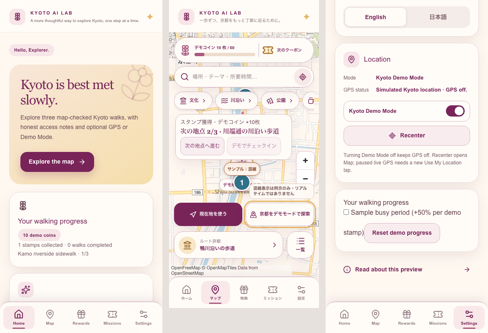

# Visual audit of the Kyoto walking prototype

**Yes, parts of this app look “vibecoded.”** The clearest example is Home after the first stamp. The app knows I’m one stop into the Kamo riverside walk. Its largest element still says “Kyoto is best met slowly,” and its primary button still says “Explore the map.” My route and progress sit in smaller type below. The screen looks polished but gives a returning walker the same pitch as a new visitor. That mismatch is a stronger signal of template-driven design than the choice of purple, rounded corners, or any particular icon. Appearance alone cannot establish how the interface was built.

From left to right, Home at 390 px, the active Kamo walk at 360 px, and Settings at 390 px. Each panel shows the app at its original CSS width.

## Where the impression comes from

| Surface | What a visitor sees | What I would change |
| --- | --- | --- |
| **Active Map — highest priority** | After stamping Shijō Bridge, the next-stop panel names Kawabata, but the sample congestion label, position marker and first pin cluster on top of each other. Search, categories, wallet and both location-mode choices still command attention. At 360 × 740 in Japanese, the congestion legend covers the bottom 9 px of the zoom-out control. The reference leaves a stretch of the dotted trail visible between recognizable landmarks. | While a walk is active, give the next stop, movement/check-in action and route line the clearest space. Put browsing and mode changes behind a secondary control. Keep the current mode visible, associate the sample disclosure with the congestion cue, and reserve separate space for zoom and attribution. [Map reference](../../references/map-tab-reference.png) · [English checkpoint capture](../review/phase-3/kamo-checkpoint.png) |
| **Welcome and Home — strongest template cues** | “Your Kyoto story starts here,” “Wander with purpose,” and the repeated header tagline all introduce the experience. Decorative rings, gold sparkles and a flower repeat the mood. Home adds a gradient feature card and later “A gentler way through the city.” Meanwhile, the real walk is represented by a line such as “Kamo riverside sidewalk · 1/3.” That same state shows the small but conspicuous copy error “1 stamps collected.” | Keep one introductory line on Welcome, the language choice and the clear start action. Give first-time Home visitors a named walk with its duration. Once a walk starts, put its name, next stop and a **Resume walk** action first. Handle singular and plural stamp counts. [Screen components](../../src/components/prototype-app.tsx) · [English copy](../../src/locales/en.json) |
| **Rewards and completion** | Postcard, tea break and journal use the same ticket outline, frame and spacing. After claiming the postcard, “Claimed” and “Earn 100 more coins” share the same faded button treatment. The completion sheet contains the earned amount and coupon name, but the small flower is the same motif used in the app header. The most rewarding moment looks much like a settings confirmation. | Show the claimed postcard as an owned item with a checkmark. Show a locked coupon’s shortfall as information and reserve the claim button for the available action. On completion, give the earned stamp or newly available coupon the most prominent position. Keep the fictional-reward disclosure. [Claimed postcard capture](../review/phase-3/claimed-postcard.png) · [Rewards component](../../src/components/game-screens.tsx) |
| **Missions** | The named stops and route descriptions are specific and worth reading. All three mission cards have the same visual weight, repeat the completion-bonus sentence, and lead to “View on Map.” An active walk can appear below another available mission. Plain circles and checkmarks do little to make the promised stamp book recognizable. | Put the active mission first with its next named stop. Fold available walks down to a short preview, and use the ordered stop list as a stamp book when a mission is opened. Make earned stamps legible by shape and text in both languages. [Missions component](../../src/components/game-screens.tsx) |
| **Settings** | Profile, Language and Location each get an icon and a dedicated card. The busy-period option uses a plain checkbox. At 390 px, its final word, “stamp),” lands on the next line beside **Reset demo progress**. In the confirmation sheet, **Cancel** and **Clear progress** touch. The consequence of resetting is well explained, but the control looks attached to an unrelated preference. | Give the bonus option its own labeled row using the spacing of the Demo Mode switch. Put reset on a separate row and add space between the confirmation actions. The existing label is clickable, so the visible checkbox size alone doesn’t establish the touch target. [Settings component](../../src/components/prototype-app.tsx) |

## What already feels designed for Kyoto

The route sheet is the strongest screen. Open **Shijō to Yasaka** and it names the three stops, gives the 11-minute estimate, explains that the walk ends before the gate stairs, and asks visitors to keep shop entrances clear. Those details help someone decide whether to take this particular walk. Its bottom sheet, serif title and purple buttons also demonstrate that the existing visual components work when the information has a clear order. [Route data](../../src/data/kyoto-walks.ts) · [Route review notes](../ROUTE_DATA.md)

The plum-and-cream palette, ticket progress meter, themed pins and five labeled tabs all have a basis in the supplied reference. I’d keep them. The temporary 京 marker is understandable during prototyping. The final fox and pin artwork can make the walker and places easier to distinguish, but fixing the overlapping labels will help even with the current assets. On desktop, Home remains a centered 520 px phone column with wide margins. That presentation is reasonable for a mobile showcase. [Design guidelines](../DESIGN_GUIDELINES.md) · [Map reference](../../references/map-tab-reference.png) · [Fox reference](../../references/fox-avatar-reference.png)

## Order of work and review checks

1. **Give the active walk room on the map.** Reopen Kamo immediately after the first stamp at 360 and 390 px in both languages. The walker should be able to find the next stop, see where the path leads, read the mode, and use both zoom buttons without a legend or label covering them.
2. **Make a returning visit feel different.** Switch to Home halfway through a walk. The route name, next stop and resume action should be the first group on screen. Then finish the walk and claim the postcard. In Rewards, a visitor should be able to distinguish owned, affordable and locked items without comparing three sentences.
3. **Finish the smaller details in the same phone pass.** Check the one-stamp summary, the two-line bonus label in Settings, the spacing around reset, and the mission list with a second route active. These can be reviewed before final artwork arrives.

**Scope and evidence.** I reviewed the local `phase-2-review` app at commit `1dca433` in Chromium. I walked through onboarding, all five tabs, route detail, simulated movement, completion, a coupon claim and reset confirmation at 390 × 800. I spot-checked Japanese Missions and active Map at 360 × 740 and Home at 1280 × 850. The image above uses fresh browser captures from an isolated profile with the development toolbar hidden. The English checkpoint and claimed-postcard links point to the existing Phase 3 captures. Physical-phone legibility in sunlight, screen-reader behavior and fluent Japanese copy quality still need separate review.
