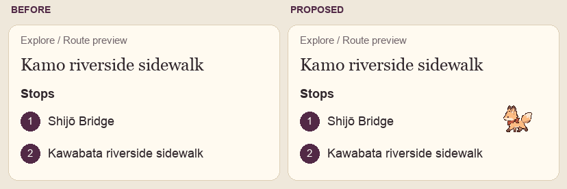
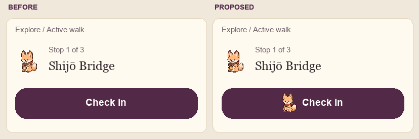
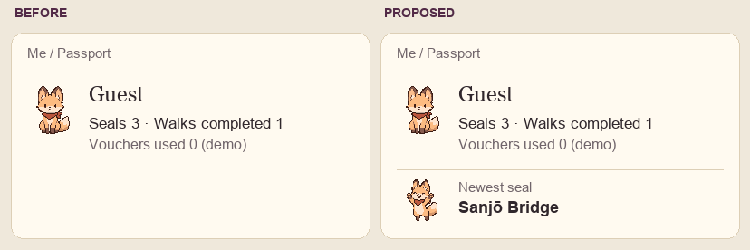
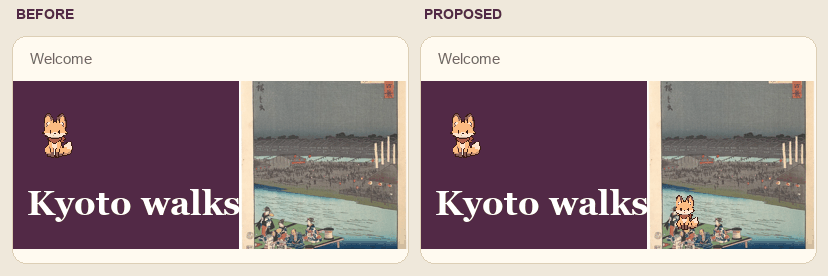
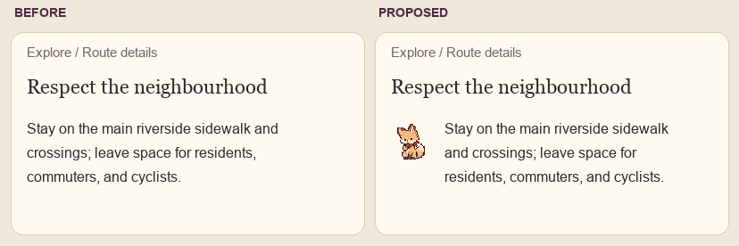
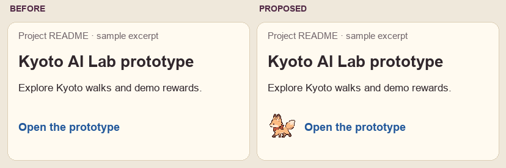
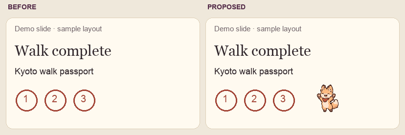

# Where the animated fox could appear

Each image pairs the existing placement on the left with a proposed placement on the right. These are cropped design mockups using the project's pixel art, GIF timing, and Kyoto welcome print. The left panels hold existing elements still so you can watch the proposed movement. The README and slide examples use illustrative baselines.

For a first trial, compare the route preview, check-in button, and passport. Each attaches a different movement to a specific moment in a walk.

### Walking fox at the first stop

The [route preview](../src/components/map/kyoto-map.tsx) already numbers the stops. Put the walking fox on the first row before the walk starts. Keep the stop number and name in place. Does your eye land on Shijō Bridge first?

### Arrived fox on the check-in button

The [follow card](../src/components/walk-controls.tsx) already shows an arrived fox beside the destination when check-in is available. Add its bow to the enabled button and hold the header avatar still in this state. Does the movement draw your eye to the action without making the label harder to read?

### Reward fox beside the newest seal

The [Me passport](../src/components/prototype-app.tsx) summarizes progress, while the [stamp book](../src/components/missions-screen.tsx) lists seals in Missions. This proposal adds a newest-seal row to Me. Show the hopping fox on the first passport visit after earning a seal. The preview repeats so you can inspect the hop.

### Idle fox inside the welcome print

The [welcome cover](../src/components/prototype-app.tsx) already has a fox beside the title. Keep that portrait still in the proposed layout and place a small breathing fox inside the river illustration. Compare the two figures at this size to decide whether the print benefits from a second fox.

### Warning fox beside the route’s resident note

The [route detail sheet](../src/components/map/kyoto-map.tsx) already shows a neighbourhood note before departure. Put the swaying fox beside the existing [route-specific wording](../src/data/kyoto-walks.ts). Compare how quickly you notice the note and how much extra wrapping the fox introduces.

### Walking fox beside a README link

If the [project README](../README.md) gains a prominent prototype link, the walking fox could sit beside its label. Both samples use the same proposed link text so you can judge the GIF on its own.

### Reward fox on a demo slide

On a slide showing a completed walk passport, put the hopping fox beside the collected seals. Compare whether the movement helps viewers notice the result while the presenter speaks. Both panels use a sample slide layout.

Across the proposed placements, use one moving fox per visible section. If a placement goes into the app, use a still frame when the viewer prefers reduced motion.
