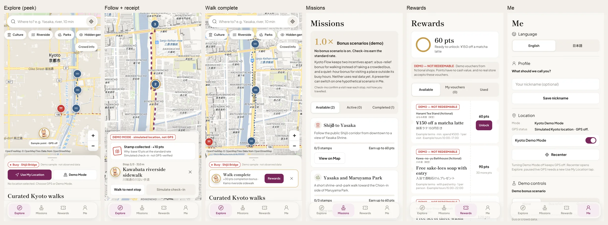

# Visual direction: learning from Macadam and Aruku&

**Goal:** keep Kyoto Flow's fox, its four tabs and its Ink & Washi colours, and borrow the *interaction patterns* that make Macadam and Aruku& feel alive: something visibly happens every time you make progress, the map tells you where to go next, and rewards feel collected rather than calculated.

**Verdict:** The prototype is calm, honest and well structured, but it rarely *reacts*. Earning a stamp, finishing a walk and unlocking a voucher each produce a small line of text. The references spend their design effort on exactly those moments. Most of what makes them fun can be adapted without breaking our product rules. The parts that can't (step-count payouts, jackpots, leagues, ad offers) are listed in [§5](#5-do-not-adopt).

Supersedes the Phase 2 visual audit (`home-map-settings.webp`), whose Home-screen findings no longer apply now that Explore is the home screen.

---

## 1. References

| File | App | Screen | What it does well |
|---|---|---|---|
| [`references/Screenshot … 4.18.31 AM.png`](../references/Screenshot%202026-11-24%20at%204.18.31%E2%80%AFAM.png) | Macadam | Map with a seasonal event | Coin pill top-left; event card with a milestone track (10 → crown 25 → 50 → 150) and a "2 days" timer; autumn leaves scattered around the avatar to collect; mascot-faced pins; dismissible celebration toast; avatar as the last tab |
| [`… 4.18.36 AM.png`](../references/Screenshot%202026-11-24%20at%204.18.36%E2%80%AFAM.png) | Macadam | Profile | Large avatar in a tier-coloured ring; Overview/Activity tabs; "Highlights" tiles (coins, crown, level, league, streak) |
| [`… 4.18.42 AM.png`](../references/Screenshot%202026-11-24%20at%204.18.42%E2%80%AFAM.png) | Macadam | Reward celebration | Full-screen moment: oversized "+100 COINS", stacked-coin art, page dots, a mascot tip card, one Continue button |
| [`… 4.18.49 AM.png`](../references/Screenshot%202026-11-24%20at%204.18.49%E2%80%AFAM.png) | Macadam | Home / step counter | Huge tabular number; chips (km, kcal); a slider track with coin milestones; a **slide-to-validate** control |
| [`… 4.18.51 AM.png`](../references/Screenshot%202026-11-24%20at%204.18.51%E2%80%AFAM.png) | Macadam | Spend | Tier track (Bronze → Silver) with lock icon; large image cards in carousels with "See all" |
| [`… 4.19.03 AM.png`](../references/Screenshot%202026-11-24%20at%204.19.03%E2%80%AFAM.png) | Aruku& | Home and map (×2 zoom levels) | Area progress HUD ("出発のまち 0/3"); characters on the map with **speech bubbles** (!, …, NEW); round labelled side buttons; a "?" help button; NEW/red-dot badges on tabs and buttons; a point-milestone chain; a collection tab of characters met |
| [`references/map-tab-reference.png`](../references/map-tab-reference.png) | Our original target | Explore map | "Next reward: Coupon!" HUD, fox speech bubble "Explore Kyoto!", route labels on lines, "Coupon Quest!" sunburst marker, place popup with photo and walk time, etiquette callout, List button |
| [`references/fox-avatar-reference.png`](../references/fox-avatar-reference.png) | Our mascot inspiration | — | The fox sheet the official art follows |

### Where we are now

Explore (peek), follow card with stamp receipt, walk complete, Missions, Rewards and Me, captured at 390 × 844 in Chromium from the current working tree.

---

## 2. Keep (non-negotiable)

| Keep | Why | Where |
|---|---|---|
| **Fox mascot, 5 states, cream-and-gold ring** | Our identity; official art is the source of truth. Never redraw or replace with CSS or generic icons | `src/components/ui.tsx` `FoxAvatar`, `public/assets/mascot/`, [`MASCOT_ASSETS.md`](MASCOT_ASSETS.md) |
| **Tabs: Explore / Missions / Rewards / Me**, Explore as home | Product decision; no Home dashboard | `src/components/bottom-nav.tsx` |
| **Ink & Washi palette**: washi `#FAF8F4`, sumi `#1C1917`, purple `#782459` for primary actions only, antique gold `#C69C4D` for achievement, vermilion `#C83E37` for seals and demo labels | Distinctly Kyoto, already tokenised | `src/app/globals.css` `:root` |
| **Type**: Shippori Mincho titles, Plus Jakarta Sans / Noto Sans JP UI, tabular numbers | Editorial, bilingual | `src/app/fonts.css` (self-hosted) |
| **Draggable sheet + follow card**, spring motion `380/32/0.9` | Already the right structure for a map-first app | `SnapSheet`, `walk-controls.tsx` |
| **印 stamp receipt, stamp book, perforated tickets** | Our equivalents of the references' collectibles; they just need more ceremony | `walk-controls.tsx`, `missions-screen.tsx`, `rewards-screen.tsx` |
| **Honesty layer**: `DEMO — NOT REDEEMABLE`, demo-scenario bonus labels, Unknown crowd, "Step-free: unknown", "confirms a visit, not how you travelled" | Required by the PRD and design system. Every new celebration must keep these visible | locales, [`IMPLEMENTATION_AUDIT.md`](../IMPLEMENTATION_AUDIT.md) §0 |

---

## 3. Pattern audit: adapt these

Each row names the reference pattern, why it works, our version, and the rule that shapes it. **P0** = do first (existing assets, high payoff), **P1** = next, **P2** = needs new art, data or approval.

### 3.1 Explore map

| # | Reference pattern | Why it's fun | Kyoto Flow version | Guardrail | Pri |
|---|---|---|---|---|---|
| E1 | Macadam coin pill top-left; our own reference's "Next reward: Coupon!" HUD | Progress is always one glance away | **Reward pill** on the map, top-left under search: ticket icon, "60 / 90 pts", thin gold progress bar. Tapping it opens Rewards. Hidden during follow mode (E3 takes over) | Points are demo; the pill links to the demo-labelled Rewards tab | P0 |
| E2 | Aruku& speech bubbles on characters; our reference's "Explore Kyoto!" bubble from the fox | The map talks to you and points at the next thing to do | **Fox speech bubble** above the idle marker with one contextual line: "Pick a walk to start" → "Next: Shijō Bridge" → "Walk complete!". Tap to open the relevant sheet. Auto-hides after a few seconds, never covers pins | Non-blocking, dismissible; max one bubble; respects reduced motion | P0 |
| E3 | Aruku& area HUD "出発のまち 0/3" with thumbnail and bar | You always know where you are in the quest | **Walk HUD** replaces the search bar during follow mode: theme icon, walk name, "Stop 2/3", segmented progress beads (one per stop, gold when stamped) | Uses existing run data; no new claims | P0 |
| E4 | Aruku& "!" / "…" / NEW bubbles on pins | Pins become invitations, not just locations | **Pin states**: next stop gets a small "!" bubble and a gold pulse (already pulses); stamped stops show a mini 印 seal; unvisited stops stay plain | Next-stop state already exists (`map-next-stop`); add seal and bubble only | P0 |
| E5 | Aruku& round labelled side buttons; our reference's List button | Tools are discoverable without menus | **Side rail** on the right: round 44 px buttons with tiny labels for List, Crowd info, Recenter and Help (?). Replaces the floating "Crowd info" pill and the recenter button inside search | 44 px targets; labels in both languages | P1 |
| E6 | Aruku& "?" help button | First-time players learn by tapping | **"How this demo works"** sheet: what a check-in proves, what demo scenarios are, why vouchers aren't real, with the `idle` fox | Turns honesty copy into onboarding instead of fine print | P1 |
| E7 | Our reference's route labels on lines ("Culture Route >") | Routes are browsable straight from the map | **Route label chips** placed at each walk line's midpoint; tap = Preview route | Same geometry; label never covers pins | P1 |
| E8 | Our reference's "Coupon Quest!" sunburst marker | Rewards have a place on the map | **Voucher marker** at the last stop of a walk that can unlock a voucher: gold ticket glyph in a sunburst, "Demo voucher" label | Must say demo; no real merchant location implied | P1 |
| E9 | Our reference's place popup with photo, tags, walk time | Places feel real and inviting | **Place card** in the sheet with category tags and walk time from the user. Photos only with a licence (e.g. Wikimedia Commons with credit); otherwise an illustrated placeholder | No unlicensed or invented imagery | P2 |
| E10 | Macadam's seasonal collectibles (leaves) around the avatar | Ambient delight; the map feels seasonal | **Momiji burst at check-in**: a few maple-leaf sprites fall around the fox for ~800 ms when a stamp is accepted (November); sakura in spring. Decorative only, never collectible on the map | Not a random-scatter collect mechanic (that rewards wandering, not verified stops); reduced motion = no animation | P1 |

### 3.2 Follow mode and the check-in moment

| # | Reference pattern | Kyoto Flow version | Guardrail | Pri |
|---|---|---|---|---|
| F1 | Macadam slide-to-validate (Valider mes pas) | Keep **one-tap Check in** (the spec asks for one tap). Use a **slide-to-confirm** only for the demo "mark as used" control, replacing hold-to-confirm: clearer affordance, same deliberateness | Slide works with keyboard (arrow/Enter) and has a tap fallback | P1 |
| F2 | Macadam + Aruku& reward feedback | **Stamp slam**: on check-in the 印 seal drops onto the receipt with a spring and a short ink-spread ring; the fox switches to `reward` for ~800 ms; `navigator.vibrate(12)` | Receipt text still states simulated/GPS and the reason for the points | P0 |
| F3 | Aruku& progress chain of coins | **Stop beads** in the follow card (same as E3) so the walker sees 1 of 3 filling | — | P0 |

### 3.3 Celebrations

| # | Reference pattern | Kyoto Flow version | Guardrail | Pri |
|---|---|---|---|---|
| C1 | Macadam full-screen "+100 COINS" with mascot tip card | **Walk-complete moment**: a full-height sheet (not a blocking modal: dismiss by tap or swipe) with the `reward` fox large, the walk name in Shippori Mincho, three seals stamping in sequence, a "+30 pts" count-up, and a fox tip card ("Your stamp book has 3 new seals"). Buttons: **See stamp book**, **Rewards** | ≤ 800 ms sequence, instant under reduced motion; "+30 pts" sits next to a small "demo" label; no confetti cannons | P0 |
| C2 | Macadam celebration toast ("jackpot won") | **Unlock toast**: when points reach a voucher, a dismissible toast slides up above the dock: fox `reward` + "Demo voucher ready: ¥150 off a matcha latte" | No prize-draw framing; links to Rewards | P0 |
| C3 | Aruku& NEW / red-dot badges | **Tab dots**: gold dot on Rewards when a voucher becomes unlockable; on Missions when new seals were added since the last visit. Cleared on visit | Dots only for real state changes; no fake urgency | P0 |

### 3.4 Missions

| # | Reference pattern | Kyoto Flow version | Guardrail | Pri |
|---|---|---|---|---|
| M1 | Aruku& home quest panel and milestone chain | **Active mission hero**: if a walk is in progress, it leads the screen with stop beads, the next stop's name and **Resume**. Available walks below as compact cards | No step counts | P0 |
| M2 | Aruku& collection tab (characters met) | **Stamp book as a collection**: each stop gets its own seal design (bridge, gate, tree, river) instead of a generic 印, with a "collected" date. Tapping a seal opens the place story | Seal art needs design approval; until then use our 1.5 px pin glyphs inside the vermilion seal | P1 (glyph) / P2 (art) |
| M3 | Aruku& residents with requests ("…" bubbles) | **Place stories**: checking in unlocks a short, sourced story card for that stop, shown with the `arrived` fox | Stories must be sourced and reviewed (PRD §10); no invented history | P2 |
| M4 | Macadam event card with timer | **Seasonal trail (demo)**: e.g. "Autumn trail: collect 5 seals" with a milestone track. A real deadline is shown only for a real campaign; demo trails say "demo, no deadline" | Timers create urgency; only use with an owned, real campaign | P2 |

### 3.5 Rewards

| # | Reference pattern | Kyoto Flow version | Guardrail | Pri |
|---|---|---|---|---|
| R1 | Macadam Spend tier track (Bronze → Silver); Macadam step-slider milestones | **Voucher track** replaces the progress ring: a horizontal track from 0 pts with a ticket marker at each voucher price (60 · 90 · 120), the current position as a fox head, locked tickets with a lock icon | Points remain "no cash value" | P0 |
| R2 | Macadam large image cards in carousels | **Illustrated ticket faces**: keep the perforated ticket, add a small category illustration on the stub (tea bowl, bath, postcard) in our line style | No logos or photos implying real merchants | P1 |

### 3.6 Me

| # | Reference pattern | Kyoto Flow version | Guardrail | Pri |
|---|---|---|---|---|
| Me1 | Macadam avatar as the last tab | **Fox face on the Me tab** (small ring, `idle` art) instead of the generic person icon | Same label "Me"; selected state still purple | P0 |
| Me2 | Macadam profile hero with large ring | **Passport header**: large fox ring, nickname, and one line: "7 seals · 2 walks · 1 voucher used (demo)". Settings sections follow | One sentence, not a tile grid (the design system bans KPI grids) | P1 |
| Me3 | Macadam "Enable notifications" card | Not now. Web push is optional and not for time-critical use (ENGINEERING_SPEC §10) | — | — |

### 3.7 Global feel

| Pattern | Kyoto Flow version | Pri |
|---|---|---|
| Both apps: bold, oversized numbers at moments of reward | Use Shippori Mincho 700 at 40–56 px **only** in celebrations (C1, R1). Everyday UI stays quiet | P0 |
| Macadam: high-contrast black pills | Use **sumi** (`#1C1917`) pills for map HUD elements (E1, E3) so they read on any basemap; purple stays reserved for primary actions | P0 |
| Aruku&: friendly empty states with the character | `idle` fox in empty Missions/Rewards states and on the map error screen | P1 |
| Both: constant micro-feedback | Haptic (`navigator.vibrate(12)`, optional) on check-in, unlock, tab change; never required | done (keep) |

---

## 4. Gaps against our own map reference

`map-tab-reference.png` already specified several of the patterns above. Built vs not built:

| Reference element | Status |
|---|---|
| Fox marker in a ring | ✅ Built (official art) |
| Search bar, category chips, List button | ✅ Search and chips built; List is the sheet (dedicated button → E5) |
| "Next reward: Coupon!" HUD | ❌ Removed with the header in the redesign → **E1** |
| "Explore Kyoto!" fox speech bubble | ❌ → **E2** |
| Route labels on lines | ❌ → **E7** |
| "Coupon Quest!" sunburst marker | ❌ → **E8** |
| Place popup with photo, tags, walk time | ◐ Text-only place view in the sheet → **E9** |
| "Please be mindful in residential areas" callout | ❌ Planned as the etiquette toast with the `warning` fox (PRD FR-17) |
| "Heavy traffic" red road bands | ✗ Intentionally not built: no live data (PRD FR-07). Demo cues stay as labelled sample badges |
| Illustrated bridges and textures | ✗ Map stays a restyled real basemap (DS §1.3) |

---

## 5. Do not adopt

| Pattern | Seen in | Why not |
|---|---|---|
| Rewards for **step counts**, kcal chips, daily goals | Macadam home, Aruku& home | PRD anti-goal (raw steps); PWAs can't read health data reliably; Kyoto Flow §2.4 bans step grinds |
| "Validate your steps **every day before midnight**" | Macadam celebration | Kyoto Flow §2.4 bans "claim before midnight" grinds; check-ins auto-credit |
| **Jackpot**, prize draws | Macadam map toast | Design system bans casino-style mechanics |
| **Leagues, friends, referrals, streaks** | Macadam profile | Design system bans leaderboards and social feeds; streaks reward daily return, not resident benefit |
| **Sponsored surveys, partner ads, charity offers** | Macadam Spend | Ad loops banned; no invented partnerships |
| **Multiple currencies** (coins, crowns, leaves, P, gems) | Both | PRD: no cash-like balances; one demo point score is already plenty |
| **Dense character clutter and heat dots** across the map | Aruku& zoomed-out map | One primary action at a time (DS §1.8); crowd colours need provenance |
| **Tier rings** (Bronze/Silver) on the avatar | Macadam | DS: the fox is a companion, not a progression system; tiers invite grinding |
| Time-limited **event timers** on demo content | Macadam event card | False urgency unless a real, owned campaign exists (M4 covers the honest version) |

---

## 6. Build plan

### P0: one pass, existing art and data ✅ implemented 2026-11-24

All P0 items below are built and covered by `tests/browser/game.mjs` ("P0 interaction layer…" and "See stamp book…"). Changes from the plan while building:
- **E2:** the fox bubble is hidden during a walk, because the walk HUD and follow card already name the next stop and the bubble clipped at the map edge.
- **C1:** the old in-sheet completion receipt was removed; the celebration replaces it.
- **C2:** the unlock toast waits until the celebration closes.
- **C3:** tab dots add an `aria-description` ("new") rather than changing the tab's name.
- **Celebration numerals:** use Kyoto Purple, not gold, because gold on washi fails contrast even at large sizes.

| Item | Files | Acceptance check |
|---|---|---|
| E1 reward pill | `kyoto-map.tsx`, `globals.css`, locales | Shows `points / next voucher`; tap opens Rewards; hidden in follow mode; 44 px target |
| E2 fox speech bubble | `kyoto-map.tsx`, `ui.tsx` | Three contextual lines in EN/JA; dismissible; never overlaps a pin at 360 px; no animation under reduced motion |
| E3 + F3 walk HUD and stop beads | `kyoto-map.tsx`, `walk-controls.tsx` | Beads match `run.stamps`; HUD replaces search only during follow mode |
| E4 pin seals and "!" bubble | `kyoto-map.tsx` (`pinMarkup`) | Stamped stops show a seal; next stop shows "!"; screen reader label unchanged |
| F2 stamp slam | `walk-controls.tsx` | Seal animates ≤ 800 ms; fox shows `reward`; receipt text unchanged |
| C1 walk-complete moment | new `celebration-sheet.tsx`, `kyoto-map.tsx` | Dismissible, non-blocking; shows demo label; instant under reduced motion; See stamp book / Rewards buttons work |
| C2 unlock toast, C3 tab dots | `prototype-app.tsx`, `bottom-nav.tsx` | Dot appears once when a voucher becomes affordable and clears on visit |
| M1 active mission hero | `missions-screen.tsx` | Active walk first with Resume; available walks below |
| R1 voucher track | `rewards-screen.tsx` | Ticket markers at 60/90/120; fox head at current points; locked icons |
| Me1 fox Me tab | `bottom-nav.tsx` | Fox ring icon; label "Me"; `aria-current` unchanged |
| Celebration type, sumi HUD pills | `globals.css` | Contrast ≥ 4.5:1 for HUD text on the map |

Tests to add: browser checks for the pill → Rewards, HUD bead count after each check-in, celebration sheet buttons and demo label, tab dot set/clear, and reduced-motion runs that skip animations.

### P1: new small components ✅ implemented 2026-11-24

All P1 items are built and covered by `tests/browser/game.mjs` ("P1: side rail…" and "P1: slide-to-confirm…"). Decisions and changes while building:
- **E7:** labels show theme + time ("Riverside · 9 min ›") instead of the full walk name (kept as the accessible name). Each theme sits at a different point along its line and opens towards the roomier side; a label that would overlap another or leave the map is hidden until the user zooms or pans. The default map centre moved east so the three walks open in view.
- **E8:** built as a walk-end goal marker, "Finish here · +30 demo pts", on the selected walk's last stop: where points are earned, never where a voucher is used.
- **E10:** sprites follow the Kyoto calendar: maple leaves Oct–Dec, cherry petals Mar–Apr, a gold sparkle otherwise.
- **F1:** slide-to-confirm replaces hold. A pointer tap alone never confirms; Enter, Space, arrow keys and assistive-technology activation do.
- **M2:** seals use the stop's theme glyph (torii, waves, leaf) in pins, receipts, the celebration and the stamp book.
- **Fox bubble** now speaks from the fox's right so it isn't clipped at the left edge.
- **Bug fixed:** a P0 rule gave map pins `position: relative`, which displaced every pin from its coordinates (by up to ~80 px). Removed.
- **Fonts** are now self-hosted (see DECISIONS.md).

E5 side rail · E6 "How this demo works" · E7 route labels · E8 voucher marker · E10 momiji burst · F1 slide-to-confirm · M2 glyph seals · R2 ticket illustrations · Me2 passport header · fox empty states.

### P2: needs art, data or approval

✅ **Implemented 2026-11-24** with the team's approval, except new fox poses (not built: they need artwork and approval; no substitute characters are generated). Covered by `tests/place-content.test.mjs` and the "P2: …" browser test.
- **E9 photos:** six Wikimedia Commons photos (CC BY 2.0, CC BY-SA 2.0/4.0, CC0), each hand-checked to show its exact place, saved at 800 px in `public/places/` by `scripts/fetch_place_photos.py`, with author, licence link and source link under every photo. Chion-in's south gate has no suitable licensed photo, so it shows an illustrated placeholder rather than another gate.
- **M3 stories:** one short EN/JA story per stop in `src/data/place-stories.ts`, every sentence restating its cited Wikipedia source (checked 2026-11-24). All are labelled **DRAFT · awaiting local review**; the Japanese needs a native review. Stories unlock at check-in and open from the stamp receipt ("Read story"), the stamp book and the place sheet.
- **M2 seals:** seven per-place line drawings (crossroads, girder bridge, tower gate, river and stepping stones, giboshi bridge, weeping cherry, temple gate) in `glyphs.tsx`, replacing the shared theme glyphs. Code-drawn placeholders, replaceable by designer seals.
- **M4 trail:** "Autumn trail (demo)" on Missions (Spring / Kyoto trail in other seasons): collect 5 different seals on any walks. Labelled demo, no deadline, no extra reward.
